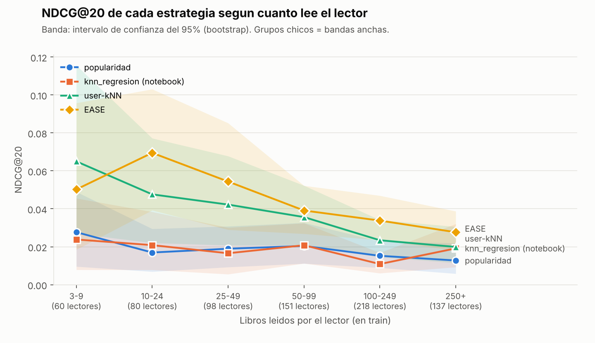

# Recomendador de libros (competencia de Kaggle)

Trabajo de la materia **Sistemas de Recomendación** (Especialización en Minería de Datos y Descubrimiento del Conocimiento, UBA). La consigna es recomendar **20 libros** a cada uno de **832 lectores**, y Kaggle lo evalúa con **NDCG@20**.

**Autora:** María Florencia Firpo

El análisis original está en el notebook de Colab (`../sistems_de_recomendacion.py`). Este proyecto lo reorganiza en módulos, le agrega una evaluación offline por lector y suma dos modelos de filtrado colaborativo.

## Resultados

Evaluación offline, con 1.000 lectores de test elegidos al azar (siempre los mismos) y N = 20:

| Estrategia | NDCG@20 | precision@20 | recall@20 | hit rate@20 |
|---|---|---|---|---|
| azar | 0,0003 | 0,0003 | 0,0003 | 0,006 |
| genero (notebook) | 0,0004 | 0,0004 | 0,0005 | 0,008 |
| knn_regresion (notebook) | 0,0619 | 0,0380 | 0,0891 | 0,394 |
| knn_regresion escalado | 0,0610 | 0,0387 | 0,0794 | 0,376 |
| popularidad | 0,1128 | 0,0629 | 0,1132 | 0,458 |
| user-kNN (k=50) | 0,2394 | 0,1064 | 0,2323 | 0,621 |
| **EASE (λ=500)** | **0,2949** | **0,1328** | **0,2902** | **0,688** |

Diferencia de NDCG@20 contra popularidad, con intervalo de confianza del 95 % (*bootstrap* pareado):

| Estrategia | Diferencia | IC 95 % |
|---|---|---|
| EASE | +0,182 | [+0,167; +0,198] |
| user-kNN | +0,127 | [+0,112; +0,141] |
| knn_regresion (notebook) | −0,051 | [−0,062; −0,040] |

### Resultados en Kaggle

| Submission | NDCG@20 (Kaggle) | vs mejor anterior |
|---|---|---|
| KNN de regresión, versión base (notebook) | 0,02247 | referencia |
| KNN de regresión con afinidad (notebook) | 0,02105 | −6 % |
| user-kNN | 0,03180 | +42 % |
| **EASE** | **0,04175** | **+86 %** |

El orden coincide con la evaluación offline (EASE > user-kNN > KNN de regresión), así que la evaluación offline sirve para elegir modelos. Los valores absolutos son mucho más bajos en Kaggle, porque su test es más difícil (ver la advertencia más abajo).

### Qué dicen estos números

1. **EASE es la mejor estrategia por lejos**: casi triplica el NDCG@20 de la popularidad. En el proyecto de recetas la mejora era de apenas +17 %. La diferencia es que acá hay más datos: 10.000 lectores con lecturas muy variadas, contra 501 usuarios con gustos parecidos.
2. **El KNN de regresión del notebook rinde peor que recomendar lo más popular.** El modelo predice qué rating le pondría el lector a un libro, pero la competencia pregunta qué libros va a leer. Un libro poco leído con promedio 9 sube en el ranking, aunque casi nadie lo elija. Además, los candidatos salen de un recorte a los 200 libros más leídos de sus géneros, así que el modelo nunca ve el resto.
3. **Escalar las variables del KNN no cambia nada.** En el notebook, `cantidad_interacciones_libro` (hasta 2.230) domina la distancia frente a los promedios (1 a 10). Probamos estandarizar las variables y el resultado es el mismo, así que el problema es el enfoque de regresión de ratings, no la escala.
4. **La estrategia por género sola no sirve** (0,0004, igual que el azar). Elegir al azar dentro de los géneros del lector sigue dejando miles de candidatos.

### Evaluación con corte temporal: la que se parece a Kaggle

`python main.py split --temporal 2024-01-01` arma train con todo lo anterior al 1/1/2024 y test con las lecturas positivas de 2024 en adelante. En test solo entran los lectores con al menos 3 lecturas previas: 744 lectores y 5.110 lecturas.

| Estrategia | NDCG@20 con corte temporal | NDCG@20 en Kaggle |
|---|---|---|
| knn_regresion (notebook) | 0,0173 | 0,0225 |
| popularidad | 0,0175 | — |
| user-kNN | 0,0337 | 0,0318 |
| **EASE** | **0,0416** | **0,0418** |

### Comparación de las tres formas de separar train y test

| Estrategia | Al azar (80/20) | Último 20 % por lector | Últimas 20 por lector | Corte global (2024) | **Kaggle** |
|---|---|---|---|---|---|
| knn_regresion (notebook) | 0,0619 | 0,0384 | 0,0529 | 0,0173 | **0,0225** |
| user-kNN | 0,2394 | 0,0970 | 0,0910 | 0,0337 | **0,0318** |
| EASE | 0,2949 | 0,1271 | 0,1442 | 0,0416 | **0,0418** |

Las cuatro evaluaciones ordenan igual a los modelos. Las tres primeras dan valores entre 3 y 7 veces más altos que Kaggle. El corte global es el único que coincide también en los valores.

`python main.py split --ultimas` esconde a cada lector su último 20 % de lecturas, ordenadas por fecha. Todas esas lecturas salen de train y a test van solo las positivas: 6.413 lectores y 44.939 lecturas.

`python main.py split --ultimos-n 20` esconde a cada lector sus últimas 20 lecturas, la misma cantidad de libros que pide la competencia. A los lectores con pocas lecturas se les esconden menos, para que les queden 3 en train. Quedan 6.936 lectores en test, con una mediana de 7 lecturas positivas cada uno.

Con el corte temporal, los puntajes offline coinciden con los de Kaggle **en orden y también en valor**: EASE da 0,0416 acá y 0,0418 allá. Es una señal fuerte de que el test de Kaggle es temporal, es decir, lo que los lectores leyeron después.

**Conclusión: el corte temporal es la evaluación a usar para elegir modelos.** El split al azar da números unas 7 veces más altos, porque esconder lecturas al azar es más fácil que predecir el futuro.

Contra popularidad, con el corte temporal: EASE +0,024 [+0,017; +0,032] y user-kNN +0,016 [+0,010; +0,023], las dos significativas. El KNN de regresión empata con la popularidad: −0,000 [−0,006; +0,005].

### Rendimiento según cuánto lee cada lector

`python main.py actividad` evalúa a todos los lectores del corte temporal (744) y separa el NDCG@20 según cuántos libros leyó cada uno en train. Genera `resultados/ndcg_por_actividad.png` y un CSV con la tabla.



| Lecturas en train | Lectores | popularidad | knn_regresion | user-kNN | EASE |
|---|---|---|---|---|---|
| 3-9 | 60 | 0,028 | 0,024 | **0,065** | 0,050 |
| 10-24 | 80 | 0,017 | 0,021 | 0,048 | **0,070** |
| 25-49 | 98 | 0,019 | 0,017 | 0,042 | **0,054** |
| 50-99 | 151 | 0,020 | 0,021 | 0,036 | **0,039** |
| 100-249 | 218 | 0,015 | 0,011 | 0,023 | **0,034** |
| 250+ | 137 | 0,013 | 0,019 | 0,020 | **0,028** |

- **EASE es la mejor estrategia en casi todos los grupos.** En el grupo de 3-9 lecturas le gana user-kNN, pero con 60 lectores los intervalos se superponen y no es una diferencia confiable.
- **A más lecturas, más bajo el NDCG para todos los modelos.** Es contraintuitivo, pero tiene explicación: los lectores muy activos leen libros más raros. El libro típico que un lector de 250+ lee en 2024 tiene apenas 5 lecturas previas, contra 78 en el grupo de 3-9. Además, solo el 39 % de sus libros de test está en el catálogo de EASE y user-kNN (los libros con 10 o más lecturas), contra el 72 % en los lectores de 3-9.
- **El KNN de regresión y la popularidad no se separan en ningún grupo.**
- La mayor ganancia de los modelos colaborativos está en los lectores de actividad baja y media (10 a 50 lecturas). Para los muy activos, el siguiente paso sería bajar `MIN_LECTURAS_LIBRO` o sumar contenido (autor, género) para llegar a la cola larga.

### Ojo con comparar el split al azar con Kaggle

El mejor puntaje en Kaggle fue 0,0225 con el KNN de regresión. Acá ese mismo modelo da 0,062. No son comparables: el test de Kaggle está oculto, tiene otros lectores y probablemente otro criterio, quizás temporal o con todas las lecturas y no solo las positivas. Esta evaluación sirve para **ordenar** las estrategias. La prueba definitiva es subir los CSV a Kaggle (`python main.py kaggle --todas`).

## Cómo está organizado

```
sistema_recomendacion_libros/
├── main.py          punto de entrada: split, evaluar, kaggle
├── config.py        rutas y parámetros
├── base_datos.py    carga de data.db (renombra genero -> genero_libro / genero_lector)
├── dataset.py       separación train / test 80/20 por lector
├── modelos.py       las 7 estrategias
├── evaluacion.py    NDCG, precision, recall, hit rate e intervalos de confianza
├── tests/           tests automáticos (pytest)
├── resultados/      gráficos (por ejemplo, NDCG según actividad del lector)
└── submissions/     CSV para subir a Kaggle (los genera main.py kaggle)
```

Los datos (`data.db` y `ejemplo.csv`) van en la carpeta de arriba (`libros/`).

## Uso

```bash
pip install pandas numpy scikit-learn pytest

python main.py split --temporal 2024-01-01   # corte por fecha (el que se parece a Kaggle)
python main.py split --ultimas       # alternativa: último 20 % de cada lector
python main.py split --ultimos-n 20  # alternativa: últimas 20 lecturas de cada lector
python main.py split                 # alternativa: 80/20 al azar por lector
python main.py evaluar               # tabla de resultados (tarda unos 8 minutos, casi todo es el KNN de regresión)
python main.py actividad             # NDCG según cuántos libros leyó cada lector (gráfico)
python main.py kaggle ease           # submissions/submission_ease.csv
python main.py kaggle --todas        # un CSV por estrategia
python -m pytest                     # tests
```

Para `kaggle` hace falta `ejemplo.csv` (la lista de los 832 lectores) en la carpeta `libros/`. Ese comando entrena con **toda** la base, no solo con train.

## Metodología

- **Cuatro splits.** El **corte global por fecha** (`--temporal AAAA-MM-DD`) es el principal, porque reproduce Kaggle. El **último 20 % por lector** (`--ultimas`), las **últimas N por lector** (`--ultimos-n N`) y el **80/20 al azar por lector** (sin opciones) sirven como referencia.
- **Los splits son solo para evaluar.** Para el CSV de Kaggle (`python main.py kaggle`), el modelo final se entrena con **toda** la base `data.db`.
  - En el temporal, todas las lecturas posteriores al corte salen de train, aunque no vayan a test. Si no, el modelo vería el futuro de otros lectores. Las pocas lecturas con fecha ilegible quedan en train.
- **Split 80/20 por lector.** A cada lector se le esconde el 20 % de sus lecturas, elegidas entre las positivas (rating ≥ 8; el 50 % de las lecturas lo cumple). Cada lector conserva al menos 3 lecturas en train. Quedan 89.559 lecturas en test, repartidas entre 7.185 lectores.
  - Esto reemplaza al `train_test_split` por filas del notebook. Ese split mezcla las filas de todos los lectores y sirve para medir RMSE, pero no responde la pregunta de la competencia: qué 20 libros recomendarle a cada lector.
- **Sin fuga de datos.** Todas las variables (promedios, cantidad de lecturas, correlación entre géneros, matrices) se calculan solo con train.
- **Filtrado colaborativo con matriz binaria** (leyó / no leyó), usando solo los libros con al menos 10 lecturas en train: unos 6.600 libros que cubren el 79 % de las lecturas. Con los 48.000 libros, la matriz de EASE no entraría en memoria.

## Estrategias

| Estrategia | Idea |
|---|---|
| `azar` | Libros al azar que el lector no leyó |
| `popularidad` | Los libros más leídos |
| `genero` | Del notebook: al azar entre los géneros del lector y sus géneros vecinos (correlación ≥ 0,15, top 3) |
| `knn_regresion` | Del notebook: candidatos por género, recortados a los 200 más leídos, ordenados por el rating que predice un `KNeighborsRegressor` (k = 20) |
| `user-kNN` | Recomienda lo que leyeron los 50 lectores más parecidos (similitud coseno) |
| `EASE` | Modelo lineal libro × libro con fórmula cerrada (Steck, 2019) |

## Tests

Cubren:
- **Último 20 % por lector**: se esconden las lecturas más recientes de cada lector, las negativas también salen de train y a test solo van las positivas.
- **Corte temporal**: en train no queda nada posterior al corte, test solo tiene lecturas positivas de lectores con pasado, se entienden los dos formatos de fecha y las fechas ilegibles quedan en train.
- **Split anti-leakage**: ninguna lectura queda en train y test a la vez, test solo tiene lecturas positivas, se respeta el 20 %, la separación es reproducible y no modifica la base original.
- **Métricas**: NDCG calculado a mano, y que premie acertar arriba.
- **Estrategias**: ninguna recomienda libros ya leídos ni repite libros, un lector desconocido recibe popularidad y user-kNN recomienda lo que leyó el lector más parecido.

## Limitaciones y próximos pasos

- `K_VECINOS` y `LAMBDA_EASE` no se ajustaron para este dataset: son los valores del proyecto de recetas. El próximo paso es ajustarlos con un corte temporal **dentro de train** (por ejemplo, validar con 2023), sin tocar el test de 2024.
- Con el corte temporal se puede probar darle más peso a las lecturas recientes, en la popularidad y en EASE.
- Para lectores sin historial, todas las estrategias caen en popularidad.
- El catálogo de EASE y user-kNN excluye los libros con menos de 10 lecturas, así que esas estrategias nunca los recomiendan.
